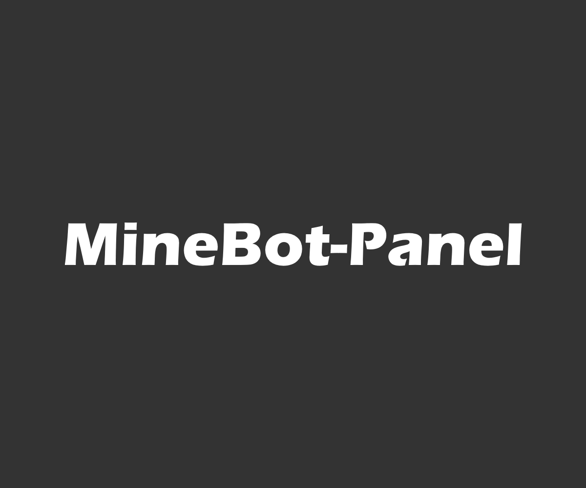

# Minebot Panel

<p align="center">
  
</p>

Panel web **local** pour piloter plusieurs bots Minecraft Java depuis le navigateur, chacun sur le serveur de ton choix : chat en temps réel, envoi de messages, suivi de la connexion.

> Projet personnel en cours de développement.

## Fonctionnalités

- Plusieurs bots, chacun sur son propre serveur : ajout, démarrage, arrêt et suppression depuis le panel
- Chat en temps réel du bot sélectionné, avec historique des 100 derniers événements
- Envoi de messages en jeu depuis le panel
- Statut de chaque bot en direct (arrêté, connexion, connecté)
- Synchronisation entre onglets : un changement fait dans un onglet apparaît dans tous les autres
- Connexion aux serveurs récents (jusqu'à **26.3**) et plus anciens grâce à [ViaProxy](https://github.com/ViaVersion/ViaProxy)
- Bots en **offline-mode** : aucun compte Microsoft nécessaire

## Technologies

Node.js · Express · Socket.IO · [Mineflayer](https://github.com/PrismarineJS/mineflayer) · mineflayer-viaproxy · HTML / CSS / JavaScript vanilla

## Prérequis

- [Node.js](https://nodejs.org) 22 ou plus récent
- Java (par exemple [Temurin](https://adoptium.net) 25), nécessaire pour ViaProxy
- Un serveur Minecraft en **offline-mode** (`online-mode=false`) qui autorise les bots

## Installation

```bash
git clone https://github.com/Xznoow/minebot-panel.git
cd minebot-panel
npm install
```

Aucune configuration n'est nécessaire. Pour changer le port du panel (3000 par défaut), copie `.env.example` en `.env` et modifie `PANEL_PORT`.

## Lancement

```bash
npm start
```

Ouvre ensuite [http://localhost:3000](http://localhost:3000). Le panel n'écoute que sur `127.0.0.1` : il n'est accessible que depuis ta machine.

### Utilisation

1. Dans le formulaire « Ajouter un bot », saisis un pseudo, l'adresse du serveur et, si besoin, son port.
2. Clique sur **Démarrer** : le statut passe à « Connexion… », puis à « Connecté ».
3. Clique sur un bot pour afficher son chat et lui faire envoyer des messages.

La liste des bots est sauvegardée dans `data/bots.json` (non versionné).

### ViaProxy

Au premier démarrage d'un bot, ViaProxy est téléchargé automatiquement dans `viaproxy/`. Tous les bots partagent ce fichier ; chacun a son propre dossier de travail dans `viaproxy/instances/`.

Pour passer à une version plus récente de ViaProxy (par exemple pour une nouvelle version de Minecraft), supprime le fichier `viaproxy/ViaProxy-*.jar` : il sera retéléchargé au démarrage suivant.

## Structure

```
├── server.js            Serveur Express + actions Socket.IO
├── src/botManager.js    Gestion des bots : statut, historique, validation
├── src/store.js         Sauvegarde de la liste des bots (data/bots.json)
└── public/              Interface web (HTML, CSS, JS)
```

## Problème connu

Les serveurs 26.3 expulsent les bots Mineflayer (`invalid_player_movement`), car Mineflayer n'envoie pas le paquet `tick_end`
([PrismarineJS/mineflayer#4189](https://github.com/PrismarineJS/mineflayer/issues/4189)).
Un contournement est intégré dans `src/botManager.js`, à retirer quand Mineflayer sera corrigé.

## Prochaines étapes

- [x] Gestion de plusieurs bots
- [x] État du bot envoyé aux navigateurs qui se connectent en cours de route
- [ ] Reconnexion automatique
- [ ] Authentification du panel

## Utilisation responsable

N'utilise ce panel que sur tes propres serveurs ou sur des serveurs dont le règlement autorise les bots.

## Auteur

Antoine Degeorges — [@Xznoow](https://github.com/Xznoow)
